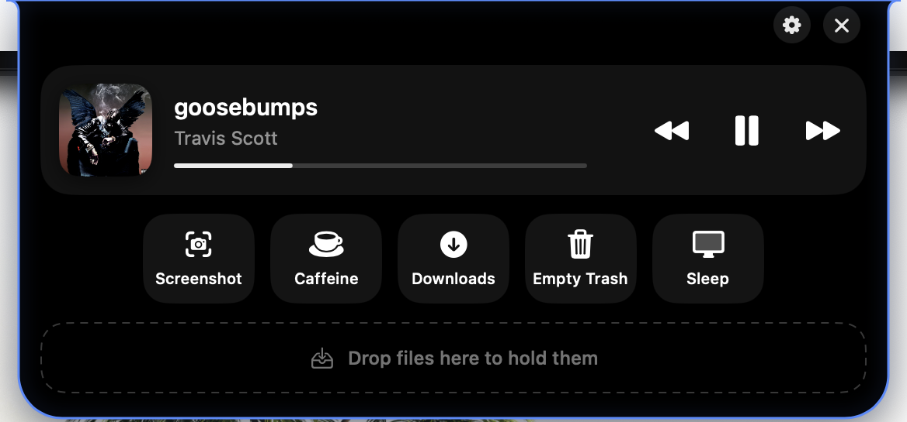
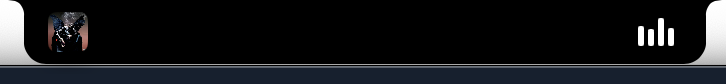

# island

A Dynamic Island for the MacBook notch.

Closed, it's just the notch. Click it (or press **fn + W** once you've granted Accessibility access) and it drops down into a black island with your music, a row of buttons you pick, and a shelf you can drop files on. Esc or click anywhere to close it.





I wanted one of the paid notch apps but figured it'd be more fun to make one that does exactly what I want and nothing else. No Dock icon, no menu bar icon, it only exists in the notch.

## what it does

- **closed + music playing**: the notch grows a bit, album art on the left ear, bouncing bars on the right. Like the phone.
- **now playing**: Music or Spotify. Artwork, title, progress bar, prev / play-pause / next. Space toggles play while it's open.
- **buttons**: a row of quick actions. Defaults are Screenshot, Caffeine (keeps your Mac awake, stays lit while on), Dark Mode, Mute, Lock, Mission Control, Downloads. There's about 35 built-ins to choose from (volume, Wi-Fi toggle, Stage Manager, Spotlight, eject all disks, empty trash, open folders/apps, copy your IP, etc) and you can also make a button open any app, open a URL, run a Shortcut, or run a shell command. Icons are SF Symbol names. Buttons center themselves if you only have a few.
- **shelf**: drop files on the notch (open or closed) and they get held there. Drag them out to the desktop or a Finder window to move them. Nothing moves until you drag it out.
- **outline**: a colored glow around the island when it's open. Pick the color in settings or turn it off.
- right click the notch for settings / quit. Launch at login is a toggle in settings.

## running it

Needs the Xcode command line tools (`xcode-select --install`). It's a plain swift package, no Xcode project.

```
git clone https://github.com/arora-developer/notch-island
cd notch-island
./make-app.sh
open Island.app
```

Or double click `Build and Run.command` in Finder, which also quits the old copy if one is running.

Two permissions, both one time:
- **Accessibility**: only needed for the fn+W shortcut. macOS asks on first launch. If you miss it, Settings > General > Grant access. (Still flaky on my machine, clicking the notch always works.)
- **Automation**: first time it talks to Music or Spotify (and System Events / Finder for the dark mode and empty trash buttons) macOS asks per app.

The build script ad-hoc signs the app, so after you *rebuild* macOS sometimes forgets the accessibility grant. If fn+W stops working, toggle Island off and on in the Accessibility list.

## how it works

The whole thing is one borderless `NSPanel` set to `.nonactivatingPanel` so it never steals focus, at window level `statusBar + 2` so it draws over the menu bar. It's positioned over the notch using `NSScreen.safeAreaInsets.top` for the height and the screen width minus `auxiliaryTopLeftArea` / `auxiliaryTopRightArea` for the width. On a screen without a notch it's a small black tab at the top.

The window gets resized to match whatever state it's in (closed = exactly the notch, open = the full island) so clicks outside it fall through to whatever's underneath. The SwiftUI stuff animates inside it. `NotchShape` draws the outline with the flared top corners so it blends into the real notch.

fn+W is a `CGEvent` tap looking for key code 13 with the `maskSecondaryFn` flag. The keystroke gets swallowed so nothing else sees it. This is the part that needs Accessibility.

Now playing is AppleScript through `osascript` on a background queue. I tried the private MediaRemote framework first but Apple locked it down in recent macOS versions, and AppleScript works fine for Music and Spotify.

Clicking the closed notch is handled in `NSPanel.sendEvent` before SwiftUI ever sees it, because going through a tap gesture on a view that's also animating on hover was laggy and ate clicks.

Files:
- `IslandView.swift` - everything you see
- `IslandController.swift` - the window and resizing
- `NotchShape.swift` - the outline
- `NowPlaying.swift` - Music / Spotify
- `Actions.swift` - the button library and settings
- `HotKey.swift` - fn+W
- `Shelf.swift`, `SettingsView.swift`

## known issues

- only Music and Spotify for now playing. Browser players don't expose anything scriptable.
- the shortcut is hardcoded to fn+W. It's one line in `HotKey.swift` if you want a different key.
- not notarized, it's ad-hoc signed. If gatekeeper complains, right click > open.

## license

MIT
